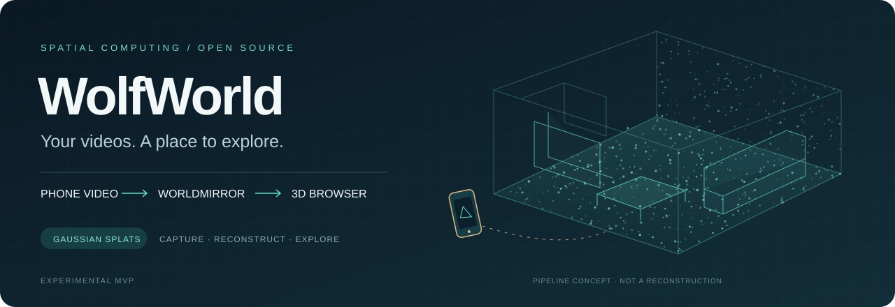
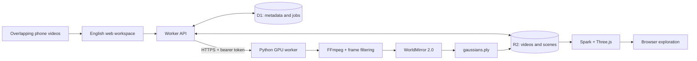

<div align="center">



# WolfWorld

**Capture a place. Reconstruct its geometry. Explore it in your browser.**

A video-to-3D workspace connecting phone footage, WorldMirror 2.0, and interactive Gaussian splatting.

[](https://github.com/quake0day/WolfWorld/actions/workflows/ci.yml)
[](LICENSE)
[](#project-status)
[](package.json)
[](worker/)

[**Quick start**](#quick-start) · [**GPU setup**](worker/README.md) · [**Research**](docs/RESEARCH.md) · [**Architecture**](docs/ARCHITECTURE.md) · [**Roadmap**](#roadmap)

</div>

---

WolfWorld turns the steps around 3D reconstruction into a usable application: organize overlapping videos, upload them in chunks, send a job to your own GPU worker, retain its output, and explore the result with mouse, keyboard, or touch controls. The included worker extracts frames and invokes the WorldMirror reconstruction pipeline; Spark and Three.js display the resulting Gaussian scene.

**Start without a GPU:** run the web app and open the attributed Spark sample, or import an existing Gaussian scene. **Reconstruct your own videos:** connect a separately configured NVIDIA GPU worker.

> [!IMPORTANT]
> **Experimental MVP; real GPU reconstruction acceptance is still pending.** API tests use mocked inference responses. CPU tests exercise real video preprocessing, not the neural model. No WolfWorld reconstruction-quality, GPU-memory, or performance benchmark is claimed. See the [validation record](docs/TESTING.md) and [GPU acceptance checklist](docs/GPU_ACCEPTANCE.md).

The [existing hosted workspace](https://wolfworld-studio.quake0day.chatgpt.site) requires owner-granted access and may retain the earlier Chinese interface. This repository contains the English edition; publishing it does not redeploy that workspace or grant access to its videos.

## Why WolfWorld?

Research repositories usually expose model inference or rendering. A capture workflow also needs upload recovery, user isolation, durable jobs, GPU connectivity, and a viewer. WolfWorld connects those pieces while keeping the reconstruction engine separate from the web application.

| Capture | Reconstruct | Explore |
| :--- | :--- | :--- |
| Upload several clips of the same static scene | Filter candidate frames and run a joint WorldMirror prediction | Open the Gaussian result in a browser |
| 8 MiB chunks; videos up to 2 GiB each | Choose a 24, 48, or 96-frame budget | Orbit, pan, zoom, WASD and touch movement |
| Preserve source files and task metadata | Inspect stages, cancel, retry, and recover from disconnects | Toggle a grid, flip orientation, reset, download |

## Project status

| Capability | Status | What that means today |
| :--- | :--- | :--- |
| English workspace and GPU guide | Implemented | Responsive UI, upload selection, presets, task history |
| Persistent uploads and metadata | Implemented | Cloudflare R2 objects and D1 records, scoped to the authenticated user |
| GPU worker protocol | Implemented and CPU-tested | Authenticated HTTP, chunked input, SQLite queue, cancellation and restart handling |
| WorldMirror 2.0 adapter | Implemented; GPU validation pending | Invokes the upstream reconstruction CLI on jointly selected frames |
| Gaussian viewer and import | Implemented | Spark + Three.js; PLY, SPZ, SPLAT, KSPLAT, SOG accepted |
| Extra gsplat optimization pass | Planned | No independent photometric refinement stage yet |
| DA3 / VGGT backend selection | Research direction | Linked alternatives, not installed or selectable backends |
| Large-scene alignment and loop closure | Planned | No global SfM/BA verification or long-sequence alignment |
| Unobserved-region generation | Not implemented | No invented rooms or automatic hole filling |
| Collision meshes and dynamic scenes | Not implemented | Camera exploration does not provide physics or 4D reconstruction |

## How it works



1. **Collect overlapping views.** Multiple clips should show common objects and surfaces.
2. **Upload and create a job.** The web API retains media and job state; the browser drives synchronization.
3. **Prepare frames.** FFmpeg samples each clip; lightweight blur and duplicate heuristics select a bounded set.
4. **Run joint reconstruction.** All selected frames go to one WorldMirror invocation. This is not a merge of independently generated PLY files.
5. **Store and render.** The worker checks basic Gaussian PLY header properties and file size; the web API stores the returned scene in R2 and exposes it to the owner.

**Job continuity:** keep the page open while video data transfers and the job starts. Once GPU computation begins, it continues independently. Reopen the page to synchronize status and copy the finished artifact back to web storage. There is no autonomous cloud queue consumer yet.

See [architecture and data flow](docs/ARCHITECTURE.md) and the [API reference](docs/API.md).

## Quick start

### 1. Run the web workspace

Use **Node.js 24 LTS** and **pnpm 11.19.0**. The package declares Node >=22.13; Node 24 is the recommended development baseline. The frontend uses React, a Next.js App Router structure, Vinext, and Cloudflare's local Worker runtime.

```bash
git clone https://github.com/quake0day/WolfWorld.git
cd WolfWorld

# If pnpm is not installed:
npm install --global pnpm@11.19.0

pnpm install --frozen-lockfile
pnpm build

# Apply once to a NEW local database.
node ./node_modules/wrangler/bin/wrangler.js d1 execute DB \
  --local --config dist/server/wrangler.json \
  --persist-to .wrangler/state \
  --file drizzle/0000_dizzy_goliath.sql

pnpm dev
```

Open **http://localhost:5173/signin-with-chatgpt?return_to=%2F** to create the local development session, then use the workspace. If port 5173 is occupied, use the port printed by the development server. The local sign-in flow supplies a development identity on loopback hosts. A GPU is unnecessary for the sample viewer and scene imports.

`.openai/hosting.json` contains only logical `DB` and `BUCKET` bindings. This public checkout does not include the original hosted project's identity, credentials, databases, uploaded videos, or model weights.

### 2. Connect a GPU worker

Prepare a Linux NVIDIA/CUDA environment using the pinned upstream revision described in the [worker guide](worker/README.md), then run:

```bash
cd worker
python -m pip install -r requirements.txt
export WORLDMIRROR_REPO=/absolute/path/to/HY-World-2.0
export WOLFWORLD_DATA=/absolute/path/to/wolfworld-data
export WOLFWORLD_TOKEN="$(python -c 'import secrets; print(secrets.token_urlsafe(32))')"
python server.py --host 127.0.0.1 --port 8788
```

Expose the worker through your HTTPS reverse proxy, save the generated token in your secret manager, and enter that endpoint and token in **Connect GPU**. Python dependencies above cover the service and preprocessing; install the upstream model environment separately. An experimental [Docker Compose configuration](worker/compose.yaml) is also included.

The worker's health check verifies prerequisites; **a healthy response is not proof of successful inference**. Complete the [first GPU acceptance run](docs/GPU_ACCEPTANCE.md) before relying on reconstruction results.

### 3. Capture a small scene

For a first experiment, use a static room and a short video taken while walking slowly. Keep shared surfaces visible as you change position, avoid abrupt exposure changes, and begin with **Quick preview**. Add a second overlapping clip after a single-clip run succeeds.

Standing in one place and rotating produces little translation-based parallax. Glass, mirrors, featureless walls, motion blur, and moving people remain difficult. These capture principles are consistent with the [COLMAP tutorial](https://colmap.github.io/tutorial.html); WolfWorld's frame heuristics do not measure or guarantee geometric coverage.

## Presets and limits

| Preset | Maximum selected frames across all clips | Target image size |
| :--- | ---: | ---: |
| Quick preview | 24 | 518 |
| Standard reconstruction | 48 | 700 |
| Detailed reconstruction | 96 | 952 |

Frame allocation is divided across the input clips; filtering may yield fewer frames. Target size is passed to the model, which controls final resizing. These are configuration values, **not measured GPU-memory requirements or quality guarantees**.

| Resource | Current setting |
| :--- | :--- |
| Video input | MP4, MOV, M4V, WebM; 1–12 clips per job |
| Per-video cap | 2 GiB; worker rejects clips longer than 30 minutes |
| Upload/transfer part size | 8 MiB, with a smaller final part |
| Scene import / returned artifact | Up to 256 MiB |
| Gaussian compression setting | Requests a maximum of 1,000,000 upstream; not independently count-enforced |
| GPU scheduling | One reconstruction at a time per worker process |
| Persistence | D1 + R2 for the app; SQLite + local files for the worker |
| Cleanup | Worker captures, outputs, logs, and model caches require administrator retention management |

**Gaussian PLY is not ordinary point-cloud PLY.** The viewer expects splat attributes such as scale, rotation, opacity, and appearance coefficients. Renaming `points.ply` to `gaussians.ply` does not convert it.

## Applications

These are intended workflows and extension opportunities, not validated customer deployments.

| Area | A useful first application | Additional work for broader use |
| :--- | :--- | :--- |
| Spatial memories | Revisit a room, studio, or personal workspace | Better capture guidance and scene sharing |
| Education | Teach multi-view geometry and compare representations | Instructor datasets and reproducible evaluation |
| Architecture and interiors | Visual walkthroughs of a captured space | Metric calibration and verified dimensions |
| Cultural documentation | Explore captured objects or interiors remotely | Capture permissions, provenance, preservation formats |
| Games and immersive media | Use captured appearance for visual prototyping | Mesh extraction, collision, lighting and engine integration |
| Robotics research | Inspect scenes and experiment with geometry backends | Calibrated geometry, semantics, navigation and evaluation |

## Research and ecosystem

WolfWorld is an application integration, not a new reconstruction model. It does not inherit every capability or benchmark from the papers below.

| Work | Why it matters | Relationship to WolfWorld |
| :--- | :--- | :--- |
| [HY-World 2.0 / WorldMirror 2.0 (2026)](https://arxiv.org/abs/2604.14268) | Multi-view reconstruction within a broader world-model framework | Current reconstruction adapter; GPU acceptance pending |
| [3D Gaussian Splatting (2023)](https://repo-sam.inria.fr/fungraph/3d-gaussian-splatting/) | Explicit Gaussian representation and efficient radiance-field rendering | Representation underlying the output and viewer |
| [Depth Anything 3 (2025)](https://arxiv.org/abs/2511.10647) | Geometry from multiple views with depth/ray predictions | Candidate alternative; streaming path worth evaluating |
| [VGGT (2025)](https://arxiv.org/abs/2503.11651) | Joint prediction of cameras and scene geometry | Candidate baseline and alignment research |
| [gsplat (2024)](https://arxiv.org/abs/2409.06765) | Gaussian rasterization and optimization infrastructure | Upstream model dependency; separate refinement is planned |
| [DUSt3R (2024)](https://arxiv.org/abs/2312.14132) | Learned pointmaps for multi-view reconstruction | Geometric background; not integrated |
| [COLMAP / SfM Revisited (2016)](https://colmap.github.io/) | Camera recovery, triangulation and bundle adjustment | Potential registration/validation stage; not integrated |
| [NeRF (2020)](https://www.matthewtancik.com/nerf) | Neural radiance fields and novel-view synthesis | Representation background; no NeRF training pipeline here |

Tools worth exploring alongside this project: [Spark](https://github.com/sparkjsdev/spark), [Three.js](https://github.com/mrdoob/three.js), [SuperSplat](https://github.com/playcanvas/supersplat), and [Brush](https://github.com/ArthurBrussee/brush).

Read the [annotated research guide](docs/RESEARCH.md) for paper/code links, reconstruction versus generation, licensing distinctions, and a practical evaluation plan. References were checked against primary sources on **September 14, 2026**.

## Development and validation

```bash
pnpm test          # API behavior, SQLite migrations, storage adapters; mocked GPU
pnpm typecheck     # TypeScript
pnpm build         # Client + server + Cloudflare Worker bundles

# In a Python environment with FFmpeg/FFprobe available:
python -m pip install -r worker/requirements.txt
python -m unittest discover -s worker -p 'test_*.py' -v
```

GitHub Actions runs the web checks and CPU worker suite without downloading model weights. See [TESTING.md](docs/TESTING.md) for exact evidence, lint status, and remaining acceptance work. Contributing code should follow [CONTRIBUTING.md](CONTRIBUTING.md).

<details>
<summary><strong>Repository map</strong></summary>

```text
WolfWorld/
├── app/                 # English workspace, viewer, worker guide, API route
├── lib/                 # API handlers, contracts, browser upload client
├── worker/              # Python HTTP service, frame selection, model adapter
├── db/                  # Drizzle schema
├── drizzle/             # SQLite/D1 migration
├── tests/               # API integration tests
├── public/              # Favicon, attributed sample, downloadable worker
├── build/               # Vendored Sites build plugin and license
├── scripts/             # Local development/build helpers
├── docs/                # Architecture, APIs, research, validation and artwork
└── .github/             # CPU CI and contribution templates
```

</details>

## Roadmap

- [x] Multi-video upload, persistent jobs and English workspace.
- [x] Authenticated worker protocol, cancellation and restart recovery.
- [x] WorldMirror invocation and Gaussian viewer integration.
- [x] Public source, setup documentation, research guide and CPU CI.
- [ ] Publish a reproducible real-GPU capture-to-viewer acceptance result.
- [ ] Add fully background transfer and result synchronization.
- [ ] Compare WorldMirror, DA3 and VGGT on the same capture set.
- [ ] Add optional COLMAP alignment checks and gsplat refinement.
- [ ] Support long sequences, loop closure and scene partitioning.
- [ ] Add compressed exports and measured mobile rendering budgets.
- [ ] Investigate mesh extraction, collision and navigable geometry.
- [ ] Explore clearly labeled completion of unseen regions with observation constraints.

The order is directional; dates and performance targets will follow evidence from GPU testing. Contributions that improve reproducibility, error handling, capture quality or documentation are especially useful.

## FAQ

**Can I film from any angle?**

Varying viewpoints are welcome, but clips need overlapping observations and useful camera motion. Arbitrary disconnected footage is not guaranteed to form one world.

**Is this a world model or a 3D scanner?**

WolfWorld uses the reconstruction component of a world-model framework. This release reconstructs observed static scenes; it does not implement a generative simulator or learn physical dynamics.

**Does reconstruction happen on my phone?**

The browser handles capture-file selection, upload and rendering. Model inference runs on the separate GPU server.

**Can I use a Mac?**

A Mac can run the web workspace and CPU tests. The included reconstruction worker targets NVIDIA CUDA on Linux; Apple Silicon model inference is not supported by this adapter.

**Do I need an OpenAI API key?**

No OpenAI model API key is required by the reconstruction workflow. Hosted Sites identity and model/GPU installation are separate concerns.

**Can I use this commercially?**

Original WolfWorld application code is MIT-licensed. Model weights, upstream model code, third-party assets and dependencies retain their own terms; the application license does not relicense them. Review [third-party notices](docs/THIRD_PARTY.md).

## License and acknowledgments

Original WolfWorld code and documentation are available under the [MIT License](LICENSE), copyright © 2026 Si Chen. Vendored code retains its notices; upstream weights are not bundled. The Spark butterfly scene is attributed sample data and is **not** a result reconstructed from user uploads.

Thanks to the teams behind [HY-World](https://github.com/Tencent-Hunyuan/HY-World-2.0), [Spark](https://github.com/sparkjsdev/spark), [Three.js](https://github.com/mrdoob/three.js), [gsplat](https://github.com/nerfstudio-project/gsplat), and the wider open research ecosystem. When reporting research results, cite the underlying models and methods you actually use; [CITATION.cff](CITATION.cff) identifies this software project separately.
