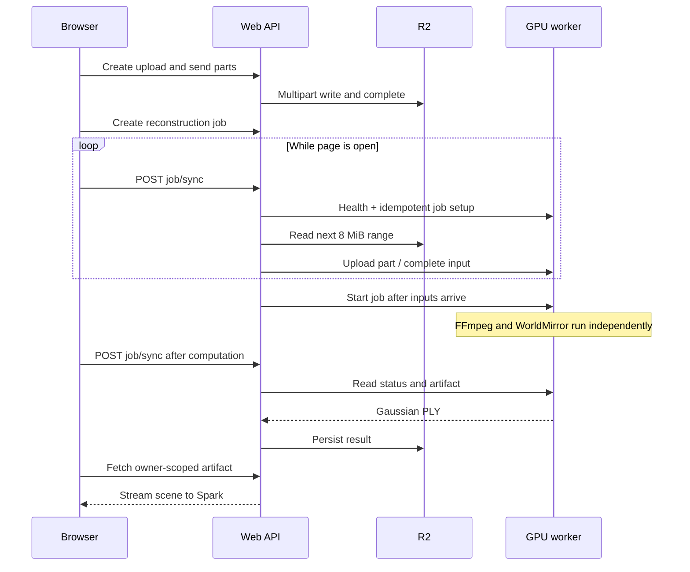

# Architecture

WolfWorld separates the browser workspace, the storage/API layer, and the GPU process. The current backend is WorldMirror 2.0; alternative model adapters are roadmap work.

## Components

| Component | Source | Responsibility |
| --- | --- | --- |
| Workspace | `app/page.tsx` | File selection, presets, job list, GPU connection, sync polling |
| Viewer | `app/viewer.tsx` | Lazy-loaded Spark/Three.js scene rendering and navigation |
| API route | `app/api/[...path]/route.ts` | Resolve runtime bindings and authenticated identity |
| API core | `lib/core.ts` | Ownership checks, multipart uploads, job transitions, remote protocol |
| Contracts | `lib/contracts.ts` | Limits, presets and shared data types |
| Database | `db/schema.ts`, `drizzle/` | D1 metadata, settings and job persistence |
| GPU service | `worker/server.py` | Bearer authentication, local uploads, durable queue and HTTP API |
| Reconstruction | `worker/engine.py` | FFmpeg preprocessing, model command, progress and basic output checks |

## Storage ownership

The app stores four tables in D1: `uploads`, `parts`, `jobs`, and `settings`. Records carrying user content are looked up with the trusted owner ID. R2 keys include owner and media/job identifiers. The worker token is stored in the D1 settings row and omitted from the browser-facing configuration response; it is not encrypted by application code.

The worker stores its queue in SQLite and files beneath `WOLFWORLD_DATA`. Inputs, intermediate frames, logs and outputs remain until an administrator removes them. Browser local storage is not the source of truth for jobs or videos.

## One job, end to end

The database lease reduces duplicate synchronization requests for the same job. It is released on completion/error and has an expiry. Temporary communication errors preserve job state and source media; they do not manufacture a successful result.

## Job states

| State | Meaning |
| --- | --- |
| `queued` | Saved in the app; waiting for worker setup or synchronization |
| `transferring` | Source data is moving to the GPU worker |
| `running` | Inputs were submitted and the worker was started |
| `complete` | The returned artifact is stored in R2 |
| `failed` | The worker reported failure |
| `cancelled` | The job was cancelled |

Retry creates a new job ID referencing the existing source videos. Worker startup marks interrupted processing jobs failed rather than pretending they survived. Progress numbers represent pipeline stages, not model-layer completion percentages.

## Reconstruction boundaries

The preprocessing stage spreads the frame budget across clips and filters candidate frames using simple image heuristics. It does not estimate camera overlap or guarantee parallax. Selected frames from all clips are passed to one model invocation; there is no independent PLY concatenation or global geometric consistency test.

The upstream command requests Gaussian output and compression to at most one million elements. The worker checks file size and selected PLY header fields; it does not fully validate the body or independently enforce the Gaussian count. The web API bounds the returned file at 256 MiB. Rendering correctness and reconstruction fidelity still need real-GPU acceptance.

## Hosting

The source uses React/Next.js routing through Vinext, plus the Cloudflare Vite plugin. `DB` and `BUCKET` are logical D1 and R2 bindings. Builds emit client, SSR, RSC and Worker outputs. The public manifest intentionally has no hosted `project_id`.

Local `pnpm dev` enables loopback-only mock sign-in through the vendored Sites plugin. Production expects a trusted identity gateway; independently deploying the Worker requires supplying authentication and protecting the origin. See [SECURITY.md](../SECURITY.md).

Publishing this repository is separate from redeploying the existing Sites workspace. Generic production provisioning, background queue workers, multi-GPU scheduling and retention automation are not implemented.
